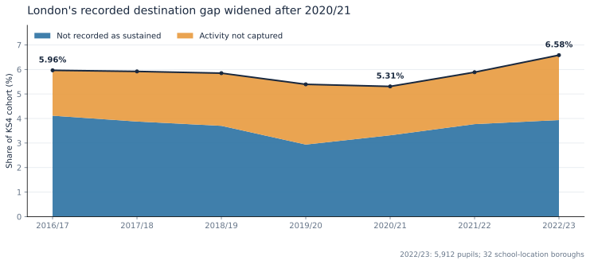
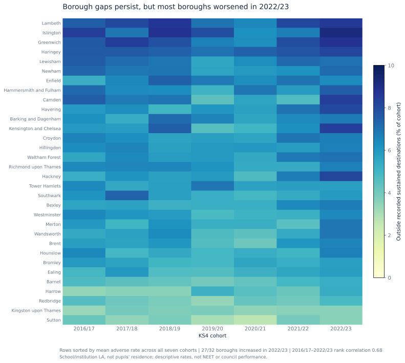
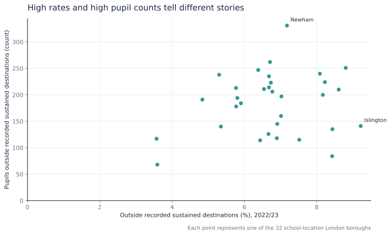
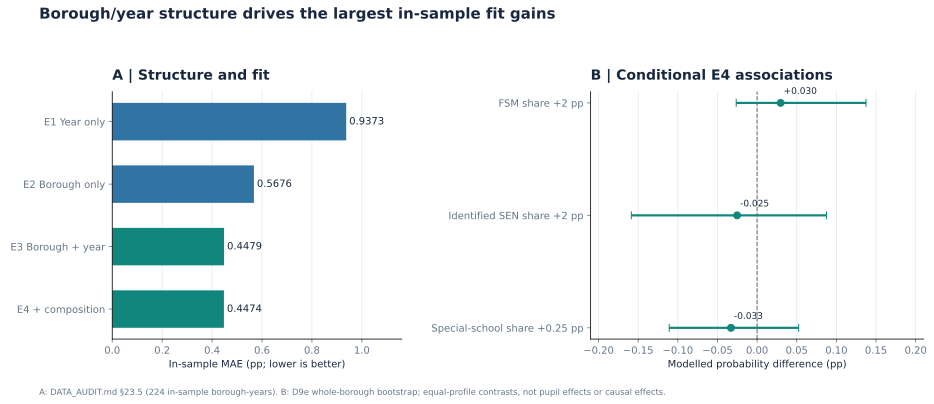
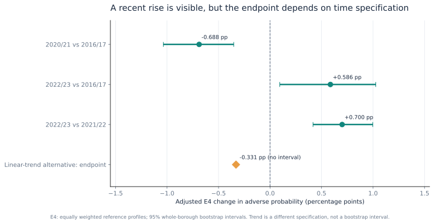
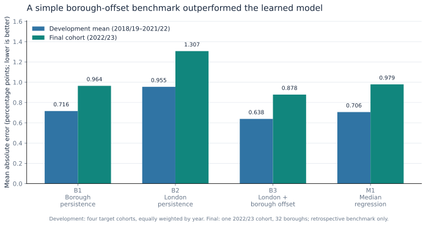
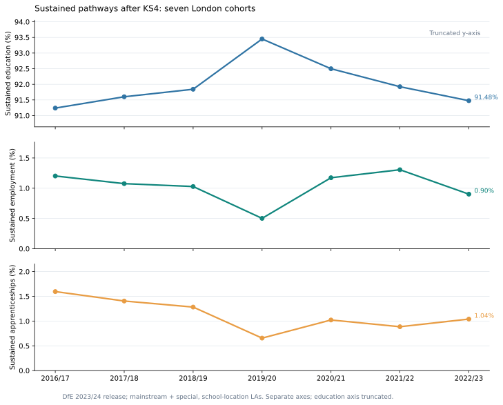
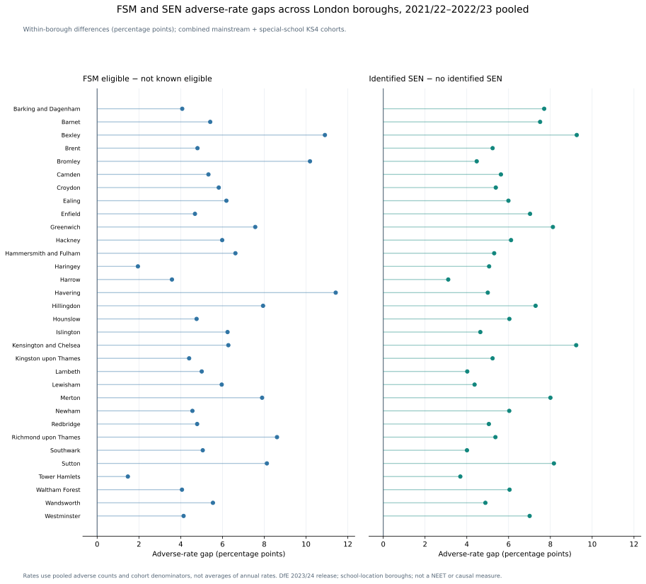

# Youth Offer for London — School-leaver destinations, disparities and forecasting

**London Data Week 2026 · Independent post-hackathon data-science rebuild**

**Challenge:** How might the Youth Offer for London be tailored to help the most young people into work or training?

This project examines where pupils are most often outside recorded sustained destinations, which groups experience persistent disparities, and whether statistical models can explain past patterns or forecast later cohorts. It then considers what the evidence can—and cannot—tell London about how to tailor support.

The analysis covers **seven KS4 cohorts (2016/17–2022/23)** and **32 London school-location boroughs**, comprising 224 borough–cohort observations for pupils leaving state-funded mainstream and special schools. It uses the frozen Department for Education (DfE) **2023/24 destination-measures release**. The primary outcome combines **`Not recorded as a sustained destination`** and **`Activity not captured`**. It is **not a direct measure of being not in education, employment or training (NEET)**; nor does this school-based population represent all young London residents.

## Findings in brief

- **Which pupils merit closer investigation?** In 2022/23, adverse rates were higher among disadvantaged pupils (approximately **10.8% versus 4.6%** for those not known disadvantaged). Exact-count comparisons also showed higher rates for pupils eligible for free school meals (FSM: **10.93% versus 4.95%** for those not known eligible) and pupils with identified special educational needs (SEN: **11.38% versus 5.63%** for those without identified SEN). Alternative-provision (AP) leavers, analysed separately, had a **34.99%** adverse rate. Yet **54.7%** of adverse records were outside FSM eligibility and, separately, **71.2%** outside identified SEN. Tailored investigation must not become exclusion by group label.
- **Where is observed need concentrated?** Lambeth, Islington, Greenwich and Haringey had the four highest seven-cohort mean rates; Newham and Croydon had the largest adverse pupil counts in 2022/23. Rates indicate prevalence, counts indicate observed scale, and neither establishes how many pupils could benefit from an intervention.
- **What did modelling contribute?** Borough and cohort-year structure substantially improved *in-sample* fit; aggregate composition added little further. In retrospective forecasting, the simple London-plus-borough-offset benchmark **B3** had lower mean absolute error than the learned model **M1** in the single final cohort (**0.878 versus 0.979 percentage points**). Neither result establishes which intervention would work.

Together, the findings justify investigating **London-wide coordination with local delivery, better destination follow-up, needs-based support available beyond higher-rate groups, and credible pilot evaluation before scaling**. They do not provide an intervention-priority ranking or an optimal funding allocation.

## Report structure

**Sections 1–3** focus on the overall adverse-destination rate: its variation across boroughs and cohorts, the associations captured by explanatory models, and retrospective forecast performance against simple benchmarks. **Sections 4–5** examine what lies beneath that rate, including recorded destination pathways and subgroup differences, before separating historical changes in group shares from changes in within-group rates. **Section 6** considers what the findings imply for the Youth Offer and what further evidence would be needed to design and evaluate support.

## 1. Historical patterns: time, place and pupil groups

The adverse rate rose from **4,505/75,538 (5.96%) in 2016/17** to **5,912/89,811 (6.58%) in 2022/23**, an increase of **0.619 percentage points (pp)**. The path was not linear: rates fell through the 2020/21 cohort before rising again. **Not recorded as a sustained destination** can include participation that fell short of the DfE sustained-duration requirement; **activity not captured** means no qualifying activity was found in the covered records. The two categories should not be treated as equivalent.



Geographic differences were persistent but not fixed. The heatmap displays every borough and cohort, ordered by each borough's **mean of its seven annual adverse rates** (each year weighted equally). The four highest seven-cohort mean rates were in **Lambeth (7.771%)**, **Islington (7.746%)**, **Greenwich (7.667%)** and **Haringey (7.564%)**, alongside substantial movement over time. In **27 of 32 boroughs**, the rate rose between 2021/22 and 2022/23. These refer to the location of pupils' schools, not necessarily their homes.



A high rate and a high count answer different questions. **Islington** had the highest 2022/23 adverse rate (**141/1,530; 9.216%**), while **Newham** had the largest count (**331/4,613; 7.175%**) and **Croydon** the second largest (**262/3,906; 6.708%**). The rate–count comparison shows why a single borough ranking would obscure part of the evidence; it is not a ranking of council performance or attainable Youth Offer impact.



The [2022/23 subgroup comparison](docs/figures/03_subgroup_disparities.svg) shows higher adverse rates among disadvantaged pupils and pupils with identified SEN, alongside differences by FSM eligibility and sex. Disadvantage rates are approximate, using published percentages weighted by disclosure-rounded cohort counts; FSM rates use exact counts but overlap with disadvantage. These differences help motivate E4's analysis of borough-level FSM and SEN shares. Later sections examine subgroup counts and gaps across boroughs, then separate changes in group shares from changes in within-group rates.

## 2. Historical structure: what do the explanatory models add?

The borough differences, shared changes across cohorts and subgroup disparities raise a question: **how much of the variation between borough–cohort rates is associated with borough identity, cohort year and borough-level pupil composition?** Four grouped-binomial logistic models address it using the same 224 observations: **E1** includes cohort-year effects, **E2** borough effects, **E3** both, and **E4** adds same-cohort FSM, identified-SEN and special-school shares.



Adding borough effects to the year-only model reduced in-sample rate MAE from **0.9373 to 0.4479 pp** (E1 versus E3); incorporating year effects into the borough-only model reduced it from **0.5676 to 0.4479 pp** (E2 versus E3). Composition then changed E3's MAE only from **0.447924 to 0.447420 pp**.

E4's hypothetical **+2 pp FSM-share** contrast was **+0.030 pp** in adverse probability (95% borough-bootstrap interval **[−0.026, +0.137]**); the **+2 pp identified-SEN-share** contrast was **−0.025 pp** (**[−0.159, +0.087]**). For a **+0.25 pp special-school-share** contrast, the estimate was **−0.033 pp** (**[−0.111, +0.052]**). All three intervals include zero. These conditional *borough-composition associations* are not individual-pupil disparities or causal effects.

E4 also estimates adjusted historical cohort contrasts, standardised to the **same 224 observed borough/composition profiles with equal profile weights** rather than London's pupil-weighted population. The adjusted **2022/23–2016/17 difference** was **+0.586 pp** (95% borough-bootstrap interval **[+0.094, +1.027] pp**). However, a predeclared linear-year-trend specification gave **−0.331 pp** for the same endpoints. This is a separate model point estimate without a bootstrap interval; the adjusted endpoint finding is **sensitive to how time is modelled**.



The explanatory models fit outcomes and (for E4) composition observed in the **same** cohorts. Their MAEs are **in-sample fit measures, not forecast scores**. E4 inference used **2,000 successful whole-borough bootstrap refits**, with six predeclared robustness families. These intervals describe uncertainty under borough resampling and model assumptions; seven common year regimes do not support confident generalisation to new temporal shocks. Detailed [fit diagnostics](DATA_AUDIT.md#235-subsequent-d9d-fit-comparison-residual-and-influence-diagnostics--locally-verified) and [estimands, uncertainty and sensitivity checks](DATA_AUDIT.md#24-d9e--explanatory-estimands-inference-and-empirical-checkpoint-accepted-methodology-exported-results-verified) are retained in the audit.

## 3. Forecasting: does a learned model improve on history?

Explaining past differences is not the same as anticipating the next cohort. A separate, frozen evaluation compared four one-cohort-ahead methods: **B1**, last year's borough rate; **B2**, last year's London rate; **B3**, the previous cohort's London rate plus an expanding-history borough offset; and **M1**, median regression using only prior-cohort adverse rate, FSM share and identified-SEN share. The primary metric was **borough-unweighted mean absolute error (MAE), in pp**.

Four chronological development target years (**2018/19–2021/22**) preceded a separately released **2022/23** final evaluation. All features, modelling rules and benchmarks were frozen before final scoring; no 2022/23-driven retuning followed.



B3 had the lowest mean annual development MAE (**0.638 pp**, against **0.706 pp** for M1) and the lowest final-cohort MAE (**0.878 pp**). On that final cohort, M1 (**0.979 pp**) did not improve on B1 borough persistence (**0.964 pp**). B3's absolute error was lower than M1's in **18 of 32 boroughs**, not all of them. One final target year cannot establish future model superiority. Moreover, B3 and M1 use different histories, so their comparison does not isolate the incremental value of FSM/SEN predictors conditional on B3.

These are **retrospective chronological comparisons on harmonised, revised data**, not operational point-in-time forecasts: historical publication vintages and feature availability at each forecast date were not established. Forecast accuracy does not demonstrate that an intervention based on a forecast would improve destinations. The [frozen development results](DATA_AUDIT.md#22-d9c--development-performance-evaluation-evidence) and [final evaluation protocol and metrics](DATA_AUDIT.md#28-d9g--released-202223-predictive-evaluation-and-final-verification) document the comparison in full.

## 4. Beyond borough averages: destinations and concentrated need

Even a useful borough forecast cannot show which pupils account for adverse records or which pathways others followed. To answer those questions, the analysis returns to the underlying destinations. In **2022/23**, the primary population's **89,811** pupils fell into five mutually exclusive recorded categories:

| Recorded destination | Pupils | Share of cohort |
| --- | ---: | ---: |
| Sustained education | 82,155 | 91.475% |
| Sustained employment | 810 | 0.902% |
| Sustained apprenticeships | 934 | 1.040% |
| Not recorded as a sustained destination | 3,535 | 3.936% |
| Activity not captured | 2,377 | 2.647% |

Sustained education is a valid post-KS4 pathway, not a poorer outcome than immediate employment. Over 2016/17–2022/23, the **not-recorded-as-sustained share fell by 0.177 pp**, while **activity not captured rose by 0.796 pp**. Their sum accounts for the overall **+0.619 pp** adverse-rate increase. Neither category confirms NEET status; for example, activity outside the covered records may go unobserved. Their different trends warrant follow-up, but do not establish whether recording practices changed.



Figure 8 uses separate vertical scales; the education axis is truncated. It shows changes within each pathway, not comparable magnitudes across panels. Sustained education was recorded for **86.92%** of FSM-eligible pupils versus **93.18%** of those not known eligible, and **86.35%** of pupils with identified SEN versus **92.50%** without identified SEN. These are descriptive pathway differences, not estimates of the effect of support.

Detailed subgroup counts show both **higher adverse rates within particular groups** and **substantial adverse numbers outside those groups**:

| 2022/23 group, primary population | Adverse / cohort | Adverse rate |
| --- | ---: | ---: |
| FSM eligible | 2,676 / 24,474 | 10.93% |
| Not known FSM eligible | 3,236 / 65,337 | 4.95% |
| Identified SEN | 1,700 / 14,943 | 11.38% |
| No identified SEN | 4,212 / 74,868 | 5.63% |

FSM and SEN are **two overlapping partitions of the same 5,912 adverse outcomes**; the four rows must not be added together. The **3,236 records outside FSM eligibility (54.7%)** and **4,212 outside identified SEN (71.2%)** show why subgroup-focused investigation must be accompanied by a broader route to help. Those counts are not estimates of the number eligible for, reachable by, or likely to benefit from the Youth Offer.

These disparities extend beyond a single borough or year. For **2021/22–2022/23 pooled**, the pupil-weighted London adverse-rate gaps were **+5.704 pp (FSM)** and **+5.955 pp (SEN)**; **both gaps were positive in all 32 boroughs**. Across all seven individual cohorts, the corresponding gaps were positive in **221/224** and **223/224** borough-years. The mainstream-only sensitivity also found positive pooled gaps in all 32 boroughs. These repeated observations indicate historical consistency, not independent confirmation of future persistence; small subgroup denominators matter.



Published disadvantage rates also differ (approximately **10.8% versus 4.6%** in 2022/23), but rounded and disclosure-controlled values cannot yield exact adverse counts. **Alternative provision**, analysed separately from the 89,811-pupil primary population, had **607/1,735 (34.99%)** adverse records in 2022/23. Small AP borough cohorts preclude reliable raw borough rankings.

Secondary comparisons also show variation: male versus female rates were **7.47% versus 5.66%**; within identified SEN, the SEN-support versus education, health and care (EHC) plan/statement rates were **12.28% versus 9.22%** (not an EHC treatment effect). Major-ethnicity rates varied (Mixed **8.46%**, White **7.73%**, Black **6.45%** in 2022/23). These school-leaver figures cannot be generalised to overall youth unemployment, and identified SEN does not capture every disability or health-related barrier. [Full subgroup results and denominators](DATA_AUDIT.md#303-d11b--production-results-and-reconciliation-6-november-2026) are in the audit.

## 5. Accounting for changes in the London rate

The subgroup gaps establish who experienced higher adverse rates, but not how much changes in group sizes contributed to London's overall trend. The rate can change because the **share of pupils in each group** changes, because the **adverse rate within each group** changes, or both. A symmetric decomposition separates these contributions for two group splits—FSM eligibility and identified SEN—using exact pupil counts.

| Comparison | Group split | Changing group shares (pp) | Changing within-group rates (pp) | Total change (pp) |
| --- | --- | ---: | ---: | ---: |
| 2016/17 → 2022/23 | FSM eligible / not known eligible | +0.480 | +0.139 | +0.619 |
| 2016/17 → 2022/23 | Identified SEN / no identified SEN | +0.170 | +0.448 | +0.619 |
| Early → recent pooled cohorts¹ | FSM eligible / not known eligible | +0.441 | −0.108 | +0.332 |
| Early → recent pooled cohorts¹ | Identified SEN / no identified SEN | +0.117 | +0.215 | +0.332 |
| 2021/22 → 2022/23 | FSM eligible / not known eligible | +0.106 | +0.591 | +0.697 |
| 2021/22 → 2022/23 | Identified SEN / no identified SEN | +0.029 | +0.667 | +0.697 |

¹ Early = 2016/17–2018/19; recent = 2021/22–2022/23. Both windows are pooled by pupil counts and exclude the intervening 2019/20–2020/21 cohorts.

In the full-period comparison, changing group shares contributed more under the FSM split, while changes in within-group rates contributed more under the SEN split. The pooled FSM within-group contribution was slightly negative; **within-group terms dominated the latest annual rise under both splits**. Of the **+0.667 pp** recent within-group contribution under the SEN split, **+0.614 pp** came from pupils *without* identified SEN. These results depend on the years compared and the group split. **Within each split, contributions from changing group shares and within-group rates sum to the observed change (subject to rounding); contributions must not be added across splits.**

These are **accounting terms, not causal explanations**. FSM and SEN classifications and the composition of successive cohorts can change; within-group rates do not track the same individuals. The [decomposition methodology](DECISIONS.md#d11c--historical-change-accounting-method-specified-6-november-2026) and [numerical results, reconciliations and sensitivity comparisons](DATA_AUDIT.md#306-d11c--production-reconciliation-and-historical-change-findings-6-november-2026) are documented separately from E4's borough-level composition associations.

## 6. What the evidence suggests for the Youth Offer

Taken together, the historical rates, counts and subgroup differences indicate **where to investigate needs**. The modelling and decomposition do not establish **which support would work** or which borough or group would gain the most from extra funding. The programme's wider resident population, individual circumstances, service reach and intervention effects are not observed in these data.

| Direction | Evidence-informed next step | Further evidence needed |
| --- | --- | --- |
| **Coordinate across London; adapt locally** | Examine borough rates, pupil counts, denominators and multi-cohort patterns together; investigate a coordinated approach with local delivery rather than a fixed high-rate shortlist. | Current **residence-based** need, referrals, eligibility, existing provision, capacity and reach before geographic resource decisions. |
| **Establish actual destinations and transition barriers** | Follow up `Not recorded as a sustained destination` and `Activity not captured` separately; investigate routes into suitable sustained education, employment and apprenticeships. | Linked/follow-up records, pupils' preferences and barriers; distinguish better ascertainment from additional sustained participation. |
| **Investigate differentiated support without exclusion** | Explore accessible advice, navigation and transition support with disadvantaged/FSM and identified-SEN pupils; assess AP leavers separately and preserve access for others. | Pupil, family and provider evidence on needs, take-up and feasibility; test proposed support rather than inferring benefit from group membership. |
| **Evaluate pilots before scaling** | Define each candidate intervention, eligibility and intended follow-up outcome before delivery. | A credible comparison with usual provision (randomised where feasible or otherwise justified), additional sustained participation, ascertainment quality, reach, equity and cost. |

The evidence identifies groups and localities for investigating support, but cannot determine an optimal allocation, individual eligibility or how many additional young people any intervention would help. Current decisions require more recent, residence-linked and service-level evidence; a separately audited newer publication-vintage comparison (**D11e**) remains deferred.

## Interpretation and research limits

- **Population and outcome:** The seven-cohort series covers state-funded mainstream and special-school leavers by **school location**. It excludes AP from the primary counts and does not represent all London-resident young people. Neither adverse component is verified NEET status.
- **Associations and accounting:** Descriptive subgroup gaps are not individual risk estimates. E4 estimates aggregate conditional associations; D11c partitions historical changes arithmetically. None estimates a causal effect, transition mechanism or intervention response. FSM and SEN overlap.
- **Precision and temporal scope:** Disadvantage rates use published rounded percentages and disclosure-rounded denominators. Small group cells constrain local comparisons; repeated boroughs and only seven common cohort-year regimes limit extrapolation. Whole-borough bootstrap intervals do not measure uncertainty over future shared shocks.
- **Prediction and implementation:** D9g tests one released final cohort on revised data, not operational point-in-time availability or treatment impact. Current needs and programme capacity are outside the dataset.

## Reproduce locally

Requires **Python 3.10+** and the DfE [**Key stage 4 destination measures 2023/24 release**](https://explore-education-statistics.service.gov.uk/find-statistics/key-stage-4-destination-measures/2023-24/explore) archive (`key-stage-4-destination-measures_2023-24.zip`). Use this specific frozen release vintage (the `ees_ks4_202223_api.csv` member contains **1,871,739 rows**), not a newer edition. The raw ZIP is **not committed**; place it at `data/raw/key-stage-4-destination-measures_2023-24.zip`. From the repository root:

```bash
python -m venv .venv
# Activate .venv using your shell's command, then:
python -m pip install -r requirements.txt
python -m unittest discover -s tests -p 'test_*.py' -v

# Frozen explanatory and chronological predictive evidence:
python scripts/run_pipeline.py
python scripts/run_final_predictive.py --release-202223-predictive-evaluation
python scripts/build_publication_figures.py

# D11 pathways, subgroup need, and historical-change accounting:
python scripts/analyse_destination_pathways.py
python scripts/analyse_destination_need.py
python scripts/analyse_historical_change.py
```

The final-predictive command **reproduces the previously authorised D9g evaluation**, not a new model-selection exercise; without the flag it performs historical-only preflight. `run_pipeline.py` writes the existing explanatory and development exports, including 2,000-attempt borough-bootstrap inference. `build_publication_figures.py` reads the raw data and those frozen outputs to generate **Figures 1–7**, without fitting models. The D11a and D11b runners separately generate **Figures 8 and 9**; D11c writes its detailed accounting CSV without a figure. All nine SVGs are committed under [`docs/figures/`](docs/figures/); intermediate `outputs/` and raw `data/raw/` remain git-ignored.

Local test runs and independent checks of exported results and source counts are documented in the audit. No CI or deployment validation is claimed.

**Repository layout:** [`scripts/`](scripts/) contains entry points; [`src/youth_offer/`](src/youth_offer/) contains reusable analysis modules; [`tests/`](tests/) contains unit and QA tests. [DECISIONS.md](DECISIONS.md) records accepted designs and frozen evaluation rules; [DATA_AUDIT.md](DATA_AUDIT.md) contains data checks, calculations, robustness results and verification checkpoints through **D11d**.

Based on the **Youth Offer for London** challenge at **London Data Week 2026**, co-hosted by **Probabl** and the **Greater London Authority's Data for London team**. Data: **Department for Education Key stage 4 destination measures**, under the **Open Government Licence**. This is an **independent post-hackathon rebuild**, distinct from the time-limited hackathon submission; it is not an official council tool or an endorsed policy recommendation.
