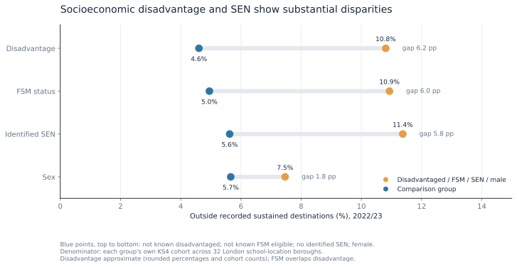

# Youth Offer for London — KS4 destination patterns and forecasting

**London Data Week 2026 · Independent post-hackathon data-science rebuild**

How can London use published school-leaver destination data to identify persistent disparities—and how much does a forecasting model add beyond simple historical benchmarks?

The original Youth Offer challenge asked how to help the most young Londoners into work or training. This KS4 dataset cannot show which interventions would work or represent all young Londoners; it can identify recorded destination patterns and test retrospective forecasting methods.

This project analyses **32 London Local Authorities × seven KS4 cohorts (2016/17–2022/23)**: 224 borough–cohort observations for pupils in state-funded mainstream and special schools. It separates **descriptive patterns**, **historical explanatory associations**, and **retrospective next-cohort prediction**.

> **Read this first:** The measured outcome is *outside recorded sustained education, employment or apprenticeship destinations*; **it is not a direct NEET rate**. Borough geography refers to the pupil's **school/institution**, not necessarily where the pupil lives. None of the analysis estimates the causal effect of an intervention.

## Results at a glance

- **Descriptive:** The London-wide adverse rate increased from **5.96% in 2016/17 to 6.58% in 2022/23** (5,912 pupils in the latter cohort). Rates and pupil counts identify different borough needs; socioeconomic and identified-SEN disparities are substantial.
- **Explanatory:** E4's adjusted **2022/23 vs 2016/17 difference was +0.586 percentage points (pp)**, with a **95% borough-bootstrap interval of [+0.094, +1.027] pp**. A predeclared linear-trend alternative reversed the point-estimate sign (**−0.331 pp**). The endpoint is **not robust to the time specification**.
- **Predictive:** In the separately released **2022/23 final evaluation**, simple benchmark **B3 (London level + historical borough offset)** had the lowest MAE (**0.878 pp**) across 32 boroughs. The learned median regression **M1 (0.979 pp)** did not beat borough persistence **B1 (0.964 pp)** on primary MAE. One final annual cohort cannot establish future superiority.

## Six headline figures, six questions

### 1. How did the London-wide outcome change?


The trend is not linear: rates fell around the 2019/20–2020/21 cohorts and subsequently increased. The chart keeps *not recorded as sustained* and *activity not captured* distinct; changes in either may partly reflect recording, not just young people's outcomes.

### 2. Which boroughs have high rates versus high pupil counts?


A high **rate** indicates relative prevalence; a high **count** indicates scale. These are school-location boroughs, and the chart is **not** a council-performance or intervention-priority ranking.

Across years, borough differences were moderately persistent and **27 of 32 boroughs experienced an increased adverse rate in 2022/23**. The supplementary [borough-by-cohort rate heatmap](docs/figures/07_borough_rate_heatmap.svg) shows all 32 boroughs across all seven cohorts; rows are ordered by their seven-cohort average, not an intervention-allocation score.

### 3. Which pupil groups show disparities?



Disadvantage and identified SEN show large **descriptive** differences. FSM overlaps with disadvantage and is corroborating—not independent—evidence. The disadvantage values are **approximate LA-aggregated rates** using the official published destination percentages and disclosure-rounded cohort weights; exact disadvantage pupil counts cannot be reconstructed from this file.

Ethnicity also shows variation in recorded destinations, although patterns differ across groups and should not be generalised to overall youth unemployment or NEET outcomes. Identified SEN does not capture every disability or health-related barrier. Other subgroup results, including within-SEN differences, are documented in [the audit](DATA_AUDIT.md#144-subgroup-disparities).

### 4. What historical structure do E1–E4 and composition associations reveal?


**Borough and cohort-year effects strongly improve in-sample fit**, while adding the same-cohort FSM, identified-SEN and special-school shares changes E3's MAE from **0.447924 pp** to **0.447420 pp**. All three E4 composition-association bootstrap intervals include zero. These are **aggregate conditional associations** after borough/year adjustments, not contradictions of raw subgroup disparities, individual-pupil effects or evidence of intervention efficacy. E1–E4 fit errors are **not out-of-sample forecast scores**; see [D9d diagnostics](DATA_AUDIT.md#235-subsequent-d9d-fit-comparison-residual-and-influence-diagnostics--locally-verified) and [D9e associations](DATA_AUDIT.md#248-composition-associations-and-independent-uncertainty-cross-check-d9e2d9e3).

### 5. How sensitive is the adjusted year comparison?


E4 standardises to the **same 224 borough/composition reference profiles with equal profile weights**. These are **not pupil-weighted London rates**. The error bars show **95% whole-borough bootstrap intervals** under the categorical-year E4 model; the trend alternative is a **separate model point estimate without an interval**. Bootstrap resampling of boroughs does not create additional independent year regimes. See [D9e evidence](DATA_AUDIT.md#24-d9e--explanatory-estimands-inference-and-empirical-checkpoint-accepted-methodology-exported-results-verified).

### 6. Did the learned forecasting model beat simple benchmarks?


All four approaches were frozen before final scoring: **B1** borough persistence, **B2** London persistence, **B3** London level plus expanding historical borough offset, and **M1** median regression using prior-cohort adverse rate, FSM share and identified-SEN share. The figure compares **mean annual development MAE** (four chronological target cohorts) with **one final-year MAE**; neither is an operational real-time backtest. In the final cohort, B3 had lower absolute error than M1 for **18 of 32 boroughs** (M1 was lower for 14); average performance does not imply that one method wins everywhere, or statistically establish superiority. See [final metrics and protocol](DATA_AUDIT.md#28-d9g--released-202223-predictive-evaluation-and-final-verification).

## Methods in brief

| Track | Purpose | Design and evaluation |
| --- | --- | --- |
| Descriptive | Compare time, geography and pupil groups | Exact headline counts and rates; disclosure-aware subgroup comparisons; alternative provision analysed separately |
| Explanatory (E1–E4) | Describe *conditional historical associations* | Grouped-binomial logistic models with year and/or borough effects; E4 adds same-cohort FSM, SEN and special-school composition; 2,000 successful whole-borough bootstrap refits and six frozen robustness families |
| Predictive (B1–B3, M1) | Test next-cohort retrospective accuracy | Chronological development targets 2018/19–2021/22, then one separately authorised 2022/23 final target; no post-release retuning; primary metric: borough-unweighted MAE in pp |

E1–E4 use contemporaneously observed outcomes and (for E4) same-cohort composition; their fitted error is **in-sample**, never a forecast score. M1 uses **previous-cohort** features only. The explanatory and predictive questions must not be conflated.

Alternative provision is a separate secondary population: **607 pupils (35.0%)** were outside recorded sustained destinations in 2022/23. These pupils are **not part of** the primary-population count of 5,912. Borough-level AP samples can be very small and should not be ranked naively. The descriptive subgroup findings do not imply intervention effects.

## Implications for the Youth Offer

These results help **frame questions for further investigation**, rather than identify a proven intervention or allocate council resources automatically. Comparing **rates and counts** distinguishes relative prevalence from the number of pupils outside recorded sustained destinations. The descriptive **disadvantage, SEN and separate alternative-provision** differences identify groups whose pathways merit closer scrutiny, but they do not establish what support would work. Because one component is *activity not captured*, improvements in destination recording must be distinguished from real improvements in sustained participation. Finally, historical forecast benchmarks offer an analytical reference, **not an operational decision system**.

## Boundaries on interpretation

- **Not NEET or causality:** An unrecorded sustained destination is not proof of NEET status; composition associations are not individual-level effects and do not identify policies that would improve outcomes.
- **Limited temporal evidence:** Only seven common year regimes and **one final predictive target cohort** are available. Boroughs share common shocks; nominal borough-bootstrap intervals do not capture uncertainty about future year regimes.
- **Not point-in-time operational forecasting:** Data are retrospectively harmonised and may have publication lags/revisions. Historical publication vintages and feature release dates were **not** verified for operational availability.
- **Reproduction evidence:** The full test suite and pipeline were run locally; D9e exports were checked for numerical consistency, and final D9g metrics were reproduced on the project checkout and cross-checked by a separate reconstruction. No CI or production-deployment validation is claimed.

## Reproduce locally

Requires Python 3.10+ and the DfE **[Key stage 4 destination measures 2023/24 release](https://explore-education-statistics.service.gov.uk/find-statistics/key-stage-4-destination-measures/2023-24/explore)** archive (`key-stage-4-destination-measures_2023-24.zip`). Use this specific release vintage (its `ees_ks4_202223_api.csv` has **1,871,739 rows**), not the newer dataset. The raw archive is **not committed**. Put it at `data/raw/key-stage-4-destination-measures_2023-24.zip`. From the repository root:

```bash
python -m venv .venv
# Activate .venv using your shell's command, then:
python -m pip install -r requirements.txt
python -m unittest discover -s tests -p 'test_*.py' -v
python scripts/run_pipeline.py
python scripts/run_final_predictive.py --release-202223-predictive-evaluation
python scripts/build_publication_figures.py
```

The separate final command **reproduces the already-authorised D9g release**, not a new model-selection exercise; running the default command without the flag instead performs historical-only preflight. `scripts/run_pipeline.py` includes the 2,000-attempt D9e inference and produces the explanatory and development CSVs. The publication plotting script **only reads** raw data and these existing frozen exports; it does not fit models. Its six headline and one supplementary SVGs are committed under `docs/figures/`, while intermediate `outputs/` files remain git-ignored.

**Repository layout:** `scripts/` contains runnable commands; `src/youth_offer/` contains reusable Python modules; `docs/figures/` holds committed publication charts; and `outputs/` plus `data/raw/` contain git-ignored local results and source data.

## Audit trail and credits

- [DECISIONS.md](DECISIONS.md) — accepted D1–D9g analytical choices and validation boundaries.
- [DATA_AUDIT.md](DATA_AUDIT.md) — source checks, descriptive findings, diagnostic evidence, uncertainty and final numerical results.
- [`scripts/`](scripts/) — runnable entry points, including [`build_publication_figures.py`](scripts/build_publication_figures.py); [`src/youth_offer/`](src/youth_offer/) — reusable analysis modules; [`tests/`](tests/) — automated QA.

Based on the **Youth Offer for London** challenge at **London Data Week 2026**, co-hosted by **Probabl** and the **Greater London Authority's Data for London team**, using **Department for Education Key stage 4 destination measures**, released under the **Open Government Licence**. This is an **independent post-hackathon rebuild**, not an official council tool or an endorsed policy recommendation. The original time-limited hackathon submission and this reproducible analysis are distinct.
